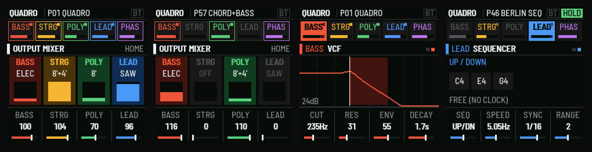
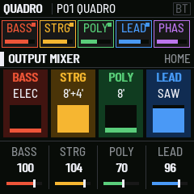
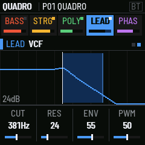
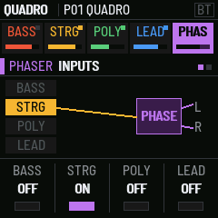
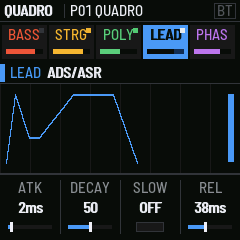
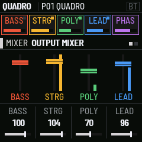
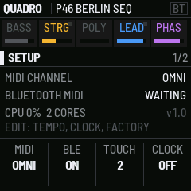

# QUADRO

**A four-section performance synthesizer for the M-VAVE FM-1, after the ARP Quadra.**

QUADRO replaces the FM-1's firmware with one big instrument. It has a bass, a string ensemble, a poly synth and a
two-voice lead, all playing at once across a split keyboard, through a 14-stage phase shifter, reverb and delay. The
whole panel is laid out for it: one knob picks the section, the buttons open its pages, and the screen shows what
each knob does as you turn it.

- **Four sections at once:** monophonic bass (electric and string), a divide-down string ensemble with three-phase
  chorus, a polyphonic synth (or paraphonic, as the original was), and a two-oscillator lead with split glide,
  vibrato, trill and two-voice mode.
- **One-finger playing:** CHORD plays a full shape from one key, and CH BASS adds its root on the bass.
- **A sequencer** over the keys you hold (up, up/down, down, random, 1–3 octaves). It syncs to MIDI clock and can
  send clock too.
- **Touch:** the FM-1's pressure-sensing keys bend the lead or open its filter, with adjustable sensitivity.
- **68 programs:** the classics, what only the Quadra could do, paraphonic, sequences, chords and one-finger band
  sounds. See [the program list](app/docs/PRESETS.md).
- **MIDI** in and out over USB, Bluetooth and TRS.
- Uses both of the FM-1's cores: the strings and poly run on the second one.

## Install

Download `quadro-X.Y.fwsc` from [Releases](../../releases). Connect the FM-1 by USB, then:

    python3 fm1_install.py quadro-X.Y.fwsc

`fm1_install.py` is in fm1-base's `tools/` (`base/tools/` here). The installer can also put M-VAVE's own firmware
back. Installing is at your own risk.

## Use

Read [the manual](app/docs/MANUAL.md). In short: **ALGO** picks the section, **EDIT / ENV / LFO / SEL** open its pages,
**FX** the phaser, **GLO** the mixer and room, **ARP** the sequencer, **PRESET** the program. **PLAY** is HOLD and
**REC** is sustain. Hold **HOME** for SETUP.

| | | |
| --- | --- | --- |
|  |  |  |
|  |  |  |

## Build

    git clone --recursive https://github.com/matttallison/matttallison-quadro-fm1
    cd matttallison-quadro-fm1
    ./build.sh                    # app/build/quadro.fwsc
    ./build.sh --release 1.0      # app/build/quadro-1.0.fwsc
    sh tests/run_tests.sh         # the sound of all 68 programs, then the host simulator

The firmware build needs the JieLi toolchain (`JIELI_TOOLCHAIN`) and the AC79 SDK (`AC79_SDK`). See
[fm1-base's README](https://github.com/charlesvestal/fm1-base). The tests only need a C compiler and Python 3.
`./build.sh --host` builds the simulator, and `app/tests/screens.txt` makes the screenshots in `app/docs/img` (`tools/make_hero.py` the banner).

A tag `vX.Y` builds, tests, signs and publishes a release on GitHub (`.github/workflows/release.yml`, using the shared
FM-1 builder).

| Path | What |
| --- | --- |
| `app/q_synth.c` | The sound: the four sections, ensemble, phaser, mixer |
| `app/q_fx.c` | The reverb and the ping-pong delay |
| `app/q_params.c` | The patch: every parameter, its range, its page |
| `app/q_presets.c` | The 68 factory programs |
| `app/q_ui.c` | The panel and the screen |
| `app/app.c` | The glue to the platform: keys, MIDI, clock, saving |
| `tests/` | The audio tests and the test runner |
| `base/` | [fm1-base](https://github.com/charlesvestal/fm1-base) (submodule) |

## Licence and credits

QUADRO is GPL-3.0 ([LICENSE](LICENSE)). It is built on fm1-base and felucca-bsp (MPL-2.0), from Felucca by Leo
Kuroshita, Hügelton Instruments. The screen font is Barlow (SIL OFL). The synthesis, effects and programs are
QUADRO's own.

ARP and Quadra are trademarks of their owners. M-VAVE and FM-1 are trademarks of their owners. QUADRO is not
affiliated with either; it is an homage, with no code, samples or text from the original.
