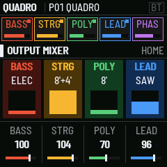
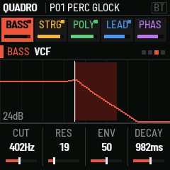
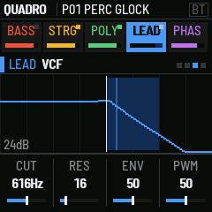
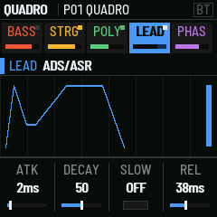
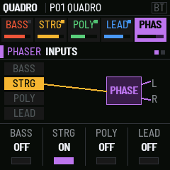
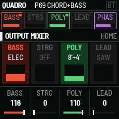
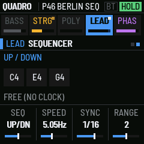
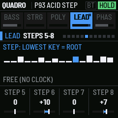
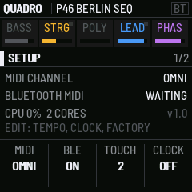

# QUADRO manual

QUADRO turns the M-VAVE FM-1 into a four-section performance synthesizer, after the ARP Quadra (1978). It has a
bass, a string ensemble, a poly synth and a two-voice lead, plus a phase shifter, a mixer, a reverb and a delay.
They all play at once and share the keyboard.

## Installing

Use the web installer at [matttallison.github.io/quadro-fm1](https://matttallison.github.io/quadro-fm1/) (Chrome or Edge, the FM-1 on USB), or
download `quadro-X.Y.fwsc` from the Releases page and run `python3 fm1_install.py quadro-X.Y.fwsc` with the FM-1 on USB. The
installer can put M-VAVE's own firmware back. Installing is at your own risk. Your programs and settings are kept when you
update (see Saving).

## The sections

| Section | What it is |
| --- | --- |
| **BASS** | A monophonic bass on the keys below the split, lowest note wins. ELEC BASS 16' and 8' through a filter with a decay envelope; the waveform, pulse width, filter type, drive and key tracking are yours. STRING BASS 16' and 8' goes through the string ensemble. |
| **STRINGS** | Divide-down string voices at 16', 8' and 4' in a waveform of your choice, with the three-phase ensemble chorus and an attack/release envelope. |
| **POLY** | A polyphonic synth: 16', 8' and 4' footages in SAW, SQR, PULSE (with PWM), TRI or SINE, detune, a filter (LP24, LP12, BP, HP), ADSR, LFO, vibrato, tremolo. PARA makes it paraphonic, with one envelope and one filter for all keys, as on the original. |
| **LEAD** | A two-oscillator monosynth on the top key. Its two oscillators each pick a waveform, with sync, a sub-oscillator and noise; it has its own filter (four types, drive, key tracking), ADS/ASR, portamento on each oscillator, vibrato, trill, two-voice mode and the sequencer. |
| **PHASER** | A 14-stage phase shifter. Each section can be routed into it. The sweep runs by itself, by sample-and-hold, from the envelope or from the LFO. |
| **MIXER** | The four section levels, the reverb, and a ping-pong delay that follows MIDI clock. |

The bass plays an octave higher than the original's, because the FM-1's keys start at F3 and its speaker can't
reproduce 40–90 Hz. Set BASS OCTAVE to −1 for the original register on headphones.

## The controls

| Control | What it does |
| --- | --- |
| **ALGO** knob | Picks the section: BASS, STRINGS, POLY, LEAD, PHASER, MIXER |
| **SEQ** | Next section |
| **EDIT** | The section's sound (voices, VCO, VCF). Press again for the next page. |
| **ENV** | The section's envelope |
| **LFO** | The section's modulation (lead: vibrato, trill, touch) |
| **SEL** | The keyboard: split, chord, chord bass, lead octave; SCALE (key, scale lock, transpose); for the lead, glide and trigger |
| **ARP** | The lead's sequencer: mode, speed and sync, then GATE and the 16 steps (press again for the next page) |
| **FX** | The phase shifter: inputs, then sweep |
| **GLO** | The output mixer, then the room, REVERB, ROOM 2, DELAY, MASTER and CHORUS pages (press again for the next) |
| **HOME** | The four sections at a glance, with knobs 1–4 as their levels. Hold it for SETUP. |
| **PRESET** knob | Loads a program, 1–105 ([the list](https://github.com/matttallison/quadro-fm1/blob/main/app/docs/PRESETS.md)) |
| **SAVE** | Saves the current sound: PRESET picks the slot, SAVE again writes, any other button cancels |
| **PLAY** | HOLD: the keys stay down, like the original's HOLD footswitch |
| **REC** | SUSTAIN: the longest release |
| **OCT− / OCT+** | Keyboard octave. Press both to go back to 0. |
| **SELECT** knob | Phaser sweep speed, always: a performance knob |
| **KNOB 1–4** | The four columns of the page on screen |
| **MASTER** | Volume |

The screen shows, from the top: the program and the latches (SUS, HOLD, clock tempo, BT, octave); the five sections,
each lit while it sounds, with its level; the page and a picture of what it sets; and the four knobs. Turning a knob
shows the parameter's full name and value.

## Sound design

Every section has OSC and FILTER pages (EDIT steps through them), so a sound can be built from nothing:

| Control | Where | Choices |
| --- | --- | --- |
| **WAVE** | bass, strings, poly, lead (both oscillators) | SAW, SQR, PULSE, TRI, SINE (the lead also has its original waveforms) |
| **PW** / **PWM** | bass, strings, poly | Pulse width; poly PWM sweeps it with the LFO |
| **DET** | poly | Detune of the voices in cents (the lead's DET is real cents too) |
| **16' / 8' / 4'** | strings, poly | Footages, each at true pitch: 8' is the key's own pitch |
| **SYNC** | lead MIX page | Oscillator 2 hard-synced to oscillator 1 |
| **SUB** / **NOISE** | lead MIX page | A sub-oscillator an octave down; white noise |
| **FMODE** | bass, poly, lead | LP24, LP12, BP, HP |
| **DRIVE** | bass, lead | Pre-filter saturation |
| **KBD** | bass, lead | Filter key tracking |
| **LFO shape** | LFO page | SINE, TRI, SAW, SQR, S&H; the bass and poly can send it to the filter, the poly to vibrato |

Programs 85–96 are examples of each.

## Effects

GLO steps through the output mixer and the effects pages:

| Page | Controls |
| --- | --- |
| **ROOM** | Reverb and delay sends, delay time, split |
| **REVERB** | DECAY, DAMP (how fast the highs die) and SIZE: ROOM, PLATE, HALL or CATHDRL |
| **ROOM 2** | PREDLY (reverb pre-delay, up to 69 ms) and the delay's MODE: PINGPONG or STEREO |
| **DELAY** | FDBK (feedback, up to near-endless), TONE (how dark the repeats get) and TIME: 1/4, 1/8, 1/16, 1/32, triplets 8T, 16T, 4T, 32T and dotted 1/8., 1/16. |
| **MASTER** | DRIVE (soft saturation), BASS and TREBLE (±12 dB shelves), COMP (a 4:1 compressor with make-up gain) |
| **CHORUS** | A stereo chorus on the whole mix (mix, rate, depth) and the stereo WIDTH (0 mono, 100 % as it is, up to 198 %) |
| **ANALOG** | DRIFT: how far each oscillator's pitch wanders over a second or two, like the original's free-running VCOs (about 1 cent at the factory 40, 5 at 127; 0 is perfectly steady) |

The master effects come after the reverb and delay, so they treat the finished sound. With all of them at their
neutral settings (DRIVE 0, BASS 0, TREBLE 0, CHORUS 0, COMP 0, WIDTH 100 %) the stage is skipped and the sound is
unchanged. They are saved with each program.

## Scale lock and transpose

SEL > SCALE sets the keyboard to a key: KEY (C to B) and SCALE (OFF, MAJOR, MINOR, DORIAN, MIXOLYD, PENT MAJ, PENT MIN,
BLUES, HARM MIN). Each pad plays the nearest note of the scale (a tie goes down), so every pad is in key. TRNSP shifts
the whole keyboard up to an octave either way. MIDI in plays what it is sent unless the page's fourth knob, MIDI, is on: then the
scale lock and TRNSP apply to the keys you play over MIDI as well.

## The Quadra's own sixteen

Programs 1–16 are the voices the ARP Quadra shipped with, set up from the switch settings on its revised patch sheets
(PERC GLOCK, PHASED STR, FAT BRASS CHOIR, SAX BRASS, PERC FUNK, PERC 2V BELLS, FUNK POWER BLAST, SCREECH BRASS, TOUCH ORCH,
JAZZ ORGAN, ETHERIALISM, SPACIAL ENCOUNTERS, BASS PHASER, PSEUDO POLY, HARPSI STR BRASS and ORCH TRIANGLE). The sheets leave
the sliders midway, so a control that was variable is at its middle and one that was preset has a fixed value; adjust to taste.
The other programs, 17–105, are listed in [the program list](PRESETS.md).

## Starting a sound

Programs 101-105 are blank templates. 101, INIT, is a plain starting point: the poly on its own, a saw, the filter open, no effects. Turn a section's
footage on (VOICES) or its level up (HOME) and it sounds: the footage brings the level up to 100, and a level raised from
zero turns on its first footage. Keys below the split play the bass whenever a bass voice is on.

## Playing

- **Split.** When a bass voice is on, keys below SPLIT play the bass, and the strings, poly and lead play above it.
  The lead always takes the top key held.
- **Chords.** CHORD (SEL page) plays a whole shape from one key on the strings and poly: MAJ, MIN, 7, MIN7, MAJ7,
  SUS4, 5TH, STACK, MIN9, ADD9, MIN6, MAJ6, DIM, AUG, SUS2, 7SUS, DOM9, MAJ9, MIN11, M7B5, OCT, 4THS or M7#11 (up to five notes: a key uses that many of the eight voices). CH BASS adds the chord's root on the bass, an octave down.
- **Paraphonic.** PARA gives the strings and poly one shared envelope and filter. Each new key restarts it.
- **Touch.** The FM-1's keys sense pressure. On the lead, TOUCH is BEND (pressure bends up) or BRILL (pressure opens
  the filter). SETUP > TOUCH sets how much it responds: 0 is off, 1 needs the hardest press, 6 the lightest (2 by default).
- **Lead unison.** FILTER > UNISON (the fourth knob) adds two copies of VCO 1 detuned up to ±19 cents each way, for a fat, beating lead.
- **Sequencer.** The lead runs UP, UP/DN, DOWN, RAND, PEDAL (the lowest key between each note), THUMB (the highest between each), CONV (out-in from both ends), DIVRG (in-out), PLAYED (the order the keys went down) or SKIP (0 2 1 3 2 4 …) over the keys held, across 1–4 octaves (RANGE). PLAY (HOLD) keeps
  it running hands-free, or turn LATCH on (the GATE page) and the sequencer keeps playing by itself after you let go of the keys; a new hand replaces what was latched. Without a clock it runs at SPEED; with MIDI clock it locks to SYNC (1/4 to 1/32, with
  triplets).
- **Step sequencer.** SEQ = STEP plays a pattern of up to 16 steps over the lowest key you hold on the lead: each
  step is a semitone offset (−24 to +24) or REST. Press ARP to step through its pages: SEQUENCER (mode, speed, sync),
  GATE (LENGTH 1–16, GATE 5–100 % of each step, LATCH), TIMING (SWING, FEEL, GRID), then STEPS 1–4 … 13–16 and ACCENTS 1–4 … 13–16, where each step
  can be an ACCENT (half as loud again) or a TIE (it runs on into the next step with no new attack and no early gate). GATE works in every sequencer mode;
  TIMING: SWING (0–50 %) sets how far steps are pushed; FEEL chooses SWING (the second step of a group late), PUSH (the second step
  long, so the first comes early) or HUMAN (every step a little off, up to SWING %); GRID sets the group: 1+1 (every pair), 2+2 or 4+4 steps.
  It works free-running and locked to MIDI clock (the clock's steps are held back, never early). The screen draws the pattern, with the step
  playing lit. Programs 97–100 are examples.

## SETUP

Hold HOME. Press EDIT to step through the four pages. Press HOME to leave.

| Page | Knob 1 | Knob 2 | Knob 3 | Knob 4 |
| --- | --- | --- | --- | --- |
| 1 | MIDI channel (OMNI, 1–16) | Bluetooth MIDI on/off | TOUCH: 0 off, 1 (least) – 6 (most sensitive) | CLOCK OUT on/off |
| 2 | TEMPO (internal clock) | RUN: START / STOP | — | FACT: turn twice to restore the 105 factory programs |
| 3 | BASS channel | STRINGS channel | POLY channel | LEAD channel |
| 4 | TAP: turn the knob in time to set the tempo | COMP: right plays the stored program, left comes back to your edit | RAND: a new random sound | — |

## MIDI

QUADRO takes MIDI over USB, Bluetooth and the TRS jack, on the SETUP channel (OMNI by default). SETUP page 3 gives each
section a channel of its own: a section with one plays only the notes on it (so the lead can play from one keyboard channel
and the poly from another); the others keep the channel of page 1. Strings and poly in PARA mode ignore the split.

| In | Does |
| --- | --- |
| Note on / off | Plays, as the keys do. Velocity sets each section's level and the bass, poly and lead cutoff (GLO > VELOCITY and VEL FILTER, 0 is off) |
| Pitch bend | ±2 semitones |
| CC 1 (mod wheel) | Lead vibrato |
| CC 64 | Sustain |
| CC 68 | FLAT footswitch: the lead one semitone down while held |
| CC 69 | HOLD footswitch: the lead gate stays open after the key goes |
| CC 74, 71, 73, 72 | The current section's cutoff, resonance, attack and release (the bass: its envelope and decay) |
| CC 91, 93, 94 | Reverb, chorus and delay amount |
| CC 20–23 | The bass, strings, poly and lead levels |
| Channel pressure | The lead's TOUCH |
| Program change 0–109 | Programs 1–105 |
| Clock, start, stop, continue | The sequencer, trill and delay follow it. The header shows the tempo. |

**Out:** the keys you play go out as notes with velocity, over USB and Bluetooth. With CLOCK OUT on, QUADRO sends
MIDI clock at TEMPO, and RUN sends start and stop. An incoming clock always wins over the internal one.

**Bluetooth MIDI:** connect from your computer's or app's Bluetooth MIDI settings. BT in the header lights once a device has connected.
SETUP > BLE turns Bluetooth off, and the setting is kept.

## Tools

SETUP page 4 has three helpers. **TAP**: turn knob 1 in time and the internal tempo follows (steady taps are averaged). **COMP**:
knob 2 right plays the stored program, left comes back to your edit, to hear what you changed. **RAND**: knob 3 gives the
section sounds new random settings (what is on, the levels, the effects and the keyboard stay). Loading another program
ends a comparison.

## Troubleshooting

- **No sound from a section.** Check that a footage is on (EDIT > VOICES) and that its level is up (HOME). With a bass voice on,
  the keys below SPLIT play the bass only. A MIDI channel set for the section (SETUP page 3) filters the notes it takes.
- **MIDI notes play too quietly or dull.** VELOCITY > level and VEL FILTER follow MIDI velocity; set them to 0 for a flat response.
- **The sequencer will not stop.** LATCH (the GATE page) and PLAY (HOLD) keep it running; turn LATCH off or press PLAY.
- **Pitch is not perfectly steady.** That is ANALOG DRIFT (GLO > ANALOG): set DRIFT to 0.
- **Back to the factory sound.** SETUP page 2, FACT: turn knob 4 twice. It restores all 105 programs and drops edited ones.

## Saving

Programs and settings are kept in the FM-1's flash. SAVE stores the current sound in a program slot; only the programs you
changed are stored, four flash parts at a time, and a part that fills up (about 21 changed programs of its 27) keeps what fits. MIDI channel,
Bluetooth, touch, clock, tempo and the section channels are saved with them.

When you update from a 0.x test build, your settings are kept and the 105 factory programs replace the old ones.

## Parameter reference

Every page, by section and button, with each control's full name, range and factory (INIT-style) default. Pages after the first of a button come with each press. Factory programs set their own values.

### BASS

**VOICES** (EDIT)

| Knob | Control | Range / choices | Default |
| --- | --- | --- | --- |
| 1 | EB16: Elec Bass 16' | OFF / ON | ON |
| 2 | EB8: Elec Bass 8' | OFF / ON | OFF |
| 3 | SB16: String Bass 16' | OFF / ON | OFF |
| 4 | SB8: String Bass 8' | OFF / ON | OFF |

**OSC** (EDIT)

| Knob | Control | Range / choices | Default |
| --- | --- | --- | --- |
| 1 | WAVE: Bass Waveform | SQR, SAW, PULSE, TRI, SINE | SQR |
| 2 | PW: Bass Pulse Width | 0 to 100 % | 50 % |
| 3 | TUNE: Bass Tune | -50 to 50 cents | 0 |
| 4 | OCT: Bass Octave | -1 to 0 | 0 |

**VCF** (EDIT)

| Knob | Control | Range / choices | Default |
| --- | --- | --- | --- |
| 1 | CUT: Bass Cutoff | 0 to 127 | 40 |
| 2 | RES: Bass Resonance | 0 to 100 % | 24 % |
| 3 | ENV: Bass Env > VCF | 0 to 100 % | 55 % |
| 4 | DECAY: Bass Decay | 0 to 127 | 80 |

**FILTER** (EDIT)

| Knob | Control | Range / choices | Default |
| --- | --- | --- | --- |
| 1 | TYPE: Bass Filter Type | LP24, LP12, BP, HP | LP24 |
| 2 | DRIVE: Bass Filter Drive | 0 to 100 % | 0 % |
| 3 | KBD: Bass Key Track | 0 to 100 % | 0 % |

**ENVELOPE** (ENV)

| Knob | Control | Range / choices | Default |
| --- | --- | --- | --- |
| 1 | DECAY: Bass Decay | 0 to 127 | 80 |
| 2 | ENV: Bass Env > VCF | 0 to 100 % | 55 % |
| 3 | SBVOL: String Bass Vol | 0 to 127 | 100 |
| 4 | REL: Strings Release | 0 to 127 | 80 |

**LFO** (LFO)

| Knob | Control | Range / choices | Default |
| --- | --- | --- | --- |
| 1 | LFO: Bass LFO > VCF | 0 to 100 % | 0 % |
| 2 | LFO: LFO Speed | 0 to 127 | 60 |
| 3 | SHAPE: LFO Waveform | SINE, TRI, SAW, SQR, S&H | SINE |

**KEYBOARD** (SEL / ARP)

| Knob | Control | Range / choices | Default |
| --- | --- | --- | --- |
| 1 | SPLIT: Bass Split | 48 to 72 | 60 |
| 2 | CHORD: Chord (One Key) | OFF, MAJ, MIN, 7, MIN7, MAJ7, SUS4, 5TH, STACK, MIN9, ADD9, MIN6, MAJ6, DIM, AUG, SUS2, 7SUS, DOM9, MAJ9, MIN11, M7B5, OCT, 4THS, M7#11 | OFF |
| 3 | CHBAS: Chord Bass (Root) | OFF, -1 OCT, -2 OCT | OFF |
| 4 | OCT: Lead Transpose | -2 to 2 | 0 |

**SCALE** (SEL / ARP)

| Knob | Control | Range / choices | Default |
| --- | --- | --- | --- |
| 1 | KEY: Scale Key | C, C#, D, D#, E, F, F#, G, G#, A, A#, B | C |
| 2 | SCALE: Scale Lock | OFF, MAJOR, MINOR, DORIAN, MIXOLYD, PENT MAJ, PENT MIN, BLUES, HARM MIN | OFF |
| 3 | TRNSP: Transpose (Semitones) | -12 to +12 semitones | 0 |
| 4 | MIDI: Scale Lock On MIDI In | OFF / ON | OFF |

### STRINGS

**VOICES** (EDIT)

| Knob | Control | Range / choices | Default |
| --- | --- | --- | --- |
| 1 | 16': Strings 16' Cello | OFF / ON | OFF |
| 2 | 8': Strings 8' Viola | OFF / ON | ON |
| 3 | 4': Strings 4' Violin | OFF / ON | ON |
| 4 | PARA: Paraphonic | OFF / ON | OFF |

**OSC** (EDIT)

| Knob | Control | Range / choices | Default |
| --- | --- | --- | --- |
| 1 | WAVE: Strings Waveform | SAW, SQR, PULSE, TRI, SINE | SAW |
| 2 | PW: Strings Pulse Width | 0 to 100 % | 50 % |

**ENSEMBLE** (EDIT)

| Knob | Control | Range / choices | Default |
| --- | --- | --- | --- |
| 1 | ENS: Ensemble Depth | 0 to 100 % | 71 % |
| 2 | TONE: Strings Tone | 0 to 100 % | 63 % |
| 3 | STRG: Phaser: Strings In | OFF / ON | ON |
| 4 | STRG: Strings Level | 0 to 127 | 100 |

**AR** (ENV)

| Knob | Control | Range / choices | Default |
| --- | --- | --- | --- |
| 1 | ATK: Strings Attack | 0 to 127 | 60 |
| 2 | REL: Strings Release | 0 to 127 | 80 |
| 4 | STRG: Strings Level | 0 to 127 | 100 |

**CHORUS** (LFO)

| Knob | Control | Range / choices | Default |
| --- | --- | --- | --- |
| 1 | ENS: Ensemble Depth | 0 to 100 % | 71 % |
| 2 | TONE: Strings Tone | 0 to 100 % | 63 % |
| 3 | LFO: LFO Speed | 0 to 127 | 60 |
| 4 | STRG: Strings Level | 0 to 127 | 100 |

**KEYBOARD** (SEL / ARP)

| Knob | Control | Range / choices | Default |
| --- | --- | --- | --- |
| 1 | SPLIT: Bass Split | 48 to 72 | 60 |
| 2 | CHORD: Chord (One Key) | OFF, MAJ, MIN, 7, MIN7, MAJ7, SUS4, 5TH, STACK, MIN9, ADD9, MIN6, MAJ6, DIM, AUG, SUS2, 7SUS, DOM9, MAJ9, MIN11, M7B5, OCT, 4THS, M7#11 | OFF |
| 3 | CHBAS: Chord Bass (Root) | OFF, -1 OCT, -2 OCT | OFF |
| 4 | OCT: Lead Transpose | -2 to 2 | 0 |

**SCALE** (SEL / ARP)

| Knob | Control | Range / choices | Default |
| --- | --- | --- | --- |
| 1 | KEY: Scale Key | C, C#, D, D#, E, F, F#, G, G#, A, A#, B | C |
| 2 | SCALE: Scale Lock | OFF, MAJOR, MINOR, DORIAN, MIXOLYD, PENT MAJ, PENT MIN, BLUES, HARM MIN | OFF |
| 3 | TRNSP: Transpose (Semitones) | -12 to +12 semitones | 0 |
| 4 | MIDI: Scale Lock On MIDI In | OFF / ON | OFF |

### POLY

**VOICES** (EDIT)

| Knob | Control | Range / choices | Default |
| --- | --- | --- | --- |
| 1 | 16': Poly 16' Sub | OFF / ON | OFF |
| 2 | 8': Poly 8' | OFF / ON | ON |
| 3 | 4': Poly 4' | OFF / ON | OFF |
| 4 | PARA: Paraphonic | OFF / ON | OFF |

**OSC** (EDIT)

| Knob | Control | Range / choices | Default |
| --- | --- | --- | --- |
| 1 | WAVE: Poly Waveform | SAW, SQR, PULSE, TRI, SINE | SAW |
| 2 | PW: Poly Pulse Width | 0 to 100 % | 50 % |
| 3 | PWM: Poly LFO > Pulse Width | 0 to 100 % | 0 % |
| 4 | DET: Poly Unison Detune | 0 to 50 cents | 0 |

**VCF** (EDIT)

| Knob | Control | Range / choices | Default |
| --- | --- | --- | --- |
| 1 | CUT: Poly VCF Cutoff | 0 to 127 | 50 |
| 2 | RES: Poly Resonance | 0 to 100 % | 8 % |
| 3 | ADSR: Poly ADSR Depth | 0 to 100 % | 47 % |
| 4 | TYPE: Poly Filter Type | LP24, LP12, BP, HP | LP24 |

**ADSR** (ENV)

| Knob | Control | Range / choices | Default |
| --- | --- | --- | --- |
| 1 | ATK: Poly Attack | 0 to 127 | 20 |
| 2 | DEC: Poly Decay | 0 to 127 | 70 |
| 3 | SUS: Poly Sustain | 0 to 100 % | 71 % |
| 4 | REL: Poly Release | 0 to 127 | 60 |

**LFO** (LFO)

| Knob | Control | Range / choices | Default |
| --- | --- | --- | --- |
| 1 | LFO: LFO Speed | 0 to 127 | 60 |
| 2 | SHAPE: LFO Waveform | SINE, TRI, SAW, SQR, S&H | SINE |
| 3 | LFO: Poly LFO > VCF | 0 to 100 % | 0 % |
| 4 | TREM: Poly Tremolo | 0 to 100 % | 0 % |

**PITCH** (LFO)

| Knob | Control | Range / choices | Default |
| --- | --- | --- | --- |
| 1 | VIB: Poly LFO > Pitch | 0 to 100 % | 0 % |
| 2 | KBD: Poly Key Track | 0 to 100 % | 50 % |

**KEYBOARD** (SEL / ARP)

| Knob | Control | Range / choices | Default |
| --- | --- | --- | --- |
| 1 | SPLIT: Bass Split | 48 to 72 | 60 |
| 2 | CHORD: Chord (One Key) | OFF, MAJ, MIN, 7, MIN7, MAJ7, SUS4, 5TH, STACK, MIN9, ADD9, MIN6, MAJ6, DIM, AUG, SUS2, 7SUS, DOM9, MAJ9, MIN11, M7B5, OCT, 4THS, M7#11 | OFF |
| 3 | CHBAS: Chord Bass (Root) | OFF, -1 OCT, -2 OCT | OFF |
| 4 | OCT: Lead Transpose | -2 to 2 | 0 |

**SCALE** (SEL / ARP)

| Knob | Control | Range / choices | Default |
| --- | --- | --- | --- |
| 1 | KEY: Scale Key | C, C#, D, D#, E, F, F#, G, G#, A, A#, B | C |
| 2 | SCALE: Scale Lock | OFF, MAJOR, MINOR, DORIAN, MIXOLYD, PENT MAJ, PENT MIN, BLUES, HARM MIN | OFF |
| 3 | TRNSP: Transpose (Semitones) | -12 to +12 semitones | 0 |
| 4 | MIDI: Scale Lock On MIDI In | OFF / ON | OFF |

### LEAD

**VCO** (EDIT)

| Knob | Control | Range / choices | Default |
| --- | --- | --- | --- |
| 1 | WAVE: Lead Waveform | SAW, SQR, 10%, PWM10, PWM50, TRI, SINE | SAW |
| 2 | VCO2: Lead VCO 2 | OFF / ON | ON |
| 3 | INT: VCO 2 Interval | -24 to +24 semitones | 0 |
| 4 | DET: VCO 2 Detune | 0 to 50 cents | 8 |

**MIX** (EDIT)

| Knob | Control | Range / choices | Default |
| --- | --- | --- | --- |
| 1 | WAVE2: VCO 2 Waveform | =VCO1, SAW, SQR, TRI, SINE | =VCO1 |
| 2 | SYNC: VCO 2 Hard Sync | OFF / ON | OFF |
| 3 | SUB: Sub Oscillator | 0 to 100 % | 0 % |
| 4 | NOISE: Noise Level | 0 to 100 % | 0 % |

**VCF** (EDIT)

| Knob | Control | Range / choices | Default |
| --- | --- | --- | --- |
| 1 | CUT: Lead VCF Cutoff | 0 to 127 | 55 |
| 2 | RES: Lead Resonance | 0 to 100 % | 24 % |
| 3 | ENV: Lead Env > VCF | 0 to 100 % | 55 % |
| 4 | PWM: Env > Pulse Width | 0 to 100 % | 50 % |

**FILTER** (EDIT)

| Knob | Control | Range / choices | Default |
| --- | --- | --- | --- |
| 1 | TYPE: Lead Filter Type | LP24, LP12, BP, HP | LP24 |
| 2 | DRIVE: Lead Filter Drive | 0 to 100 % | 0 % |
| 3 | KBD: Lead Key Track | 0 to 100 % | 25 % |
| 4 | UNISON: Lead Unison Detune | 0 to 100 % | 0 % |

**ADS/ASR** (ENV)

| Knob | Control | Range / choices | Default |
| --- | --- | --- | --- |
| 1 | ATK: Lead Attack | 0 to 127 | 10 |
| 2 | DECAY: Lead Decay Time | 0 to 100 % | 50 % |
| 3 | SLOW: Sustain Low | OFF / ON | OFF |
| 4 | REL: Lead Release | 0 to 127 | 50 |

**VIBRATO** (LFO)

| Knob | Control | Range / choices | Default |
| --- | --- | --- | --- |
| 1 | VIB: Vibrato Depth | 0 to 100 % | 0 % |
| 2 | VDEL: Vibrato Delay | 0 to 127 | 80 |
| 3 | TRILL: Trill Interval | 0 to 24 semitones | 0 |
| 4 | TOUCH: Touch Sensor | OFF, BEND, BRILL | BEND |

**LFO** (LFO)

| Knob | Control | Range / choices | Default |
| --- | --- | --- | --- |
| 1 | LFO: LFO Speed | 0 to 127 | 60 |
| 2 | SHAPE: LFO Waveform | SINE, TRI, SAW, SQR, S&H | SINE |

**PLAY** (SEL / ARP)

| Knob | Control | Range / choices | Default |
| --- | --- | --- | --- |
| 1 | 2VOIC: 2 Voice On | OFF / ON | OFF |
| 2 | POR1: VCO 1 Portamento | 0 to 127 | 0 |
| 3 | POR2: VCO 2 Portamento | 0 to 127 | 0 |
| 4 | TRIG: Keyboard Trigger | SINGL, MULTI | MULTI |

**SCALE** (SEL / ARP)

| Knob | Control | Range / choices | Default |
| --- | --- | --- | --- |
| 1 | KEY: Scale Key | C, C#, D, D#, E, F, F#, G, G#, A, A#, B | C |
| 2 | SCALE: Scale Lock | OFF, MAJOR, MINOR, DORIAN, MIXOLYD, PENT MAJ, PENT MIN, BLUES, HARM MIN | OFF |
| 3 | TRNSP: Transpose (Semitones) | -12 to +12 semitones | 0 |
| 4 | MIDI: Scale Lock On MIDI In | OFF / ON | OFF |

**SEQUENCER** (SEL / ARP)

| Knob | Control | Range / choices | Default |
| --- | --- | --- | --- |
| 1 | SEQ: Sequencer | OFF, UP, UP/DN, DOWN, RAND, STEP, PEDAL, THUMB, CONV, DIVRG, PLAYED, SKIP | OFF |
| 2 | SPEED: Trill / Seq Speed | 0 to 127 | 50 |
| 3 | SYNC: Sync To MIDI Clock | OFF, 1/4, 1/8, 1/8T, 1/16, 1/16T, 1/32 | 1/16 |
| 4 | RANGE: Sequencer Range | 1 to 4 | 1 |

**GATE** (SEL / ARP)

| Knob | Control | Range / choices | Default |
| --- | --- | --- | --- |
| 1 | LENGTH: Step Sequencer Length | 1 to 16 | 8 |
| 2 | GATE: Sequencer Gate Length | 5 to 100 | 100 |
| 3 | LATCH: Sequencer Latch | OFF / ON | OFF |

**TIMING** (SEL / ARP)

| Knob | Control | Range / choices | Default |
| --- | --- | --- | --- |
| 1 | SWING: Sequencer Swing | 0 to 50 | 0 |
| 2 | FEEL: Sequencer Timing Feel | SWING / PUSH / HUMAN | SWING |
| 3 | GRID: Swing Group | 1+1 / 2+2 / 4+4 | 1+1 |

**STEPS 1-4** (SEL / ARP)

| Knob | Control | Range / choices | Default |
| --- | --- | --- | --- |
| 1 | STEP 1: Sequencer Step 1 | REST, -24 to +24 semitones | +0 |
| 2 | STEP 2: Sequencer Step 2 | REST, -24 to +24 semitones | +0 |
| 3 | STEP 3: Sequencer Step 3 | REST, -24 to +24 semitones | +12 |
| 4 | STEP 4: Sequencer Step 4 | REST, -24 to +24 semitones | +0 |

**STEPS 5-8** (SEL / ARP)

| Knob | Control | Range / choices | Default |
| --- | --- | --- | --- |
| 1 | STEP 5: Sequencer Step 5 | REST, -24 to +24 semitones | +3 |
| 2 | STEP 6: Sequencer Step 6 | REST, -24 to +24 semitones | +0 |
| 3 | STEP 7: Sequencer Step 7 | REST, -24 to +24 semitones | +7 |
| 4 | STEP 8: Sequencer Step 8 | REST, -24 to +24 semitones | +10 |

**STEPS 9-12** (SEL / ARP)

| Knob | Control | Range / choices | Default |
| --- | --- | --- | --- |
| 1 | STEP 9: Sequencer Step 9 | REST, -24 to +24 semitones | +0 |
| 2 | STEP 10: Sequencer Step 10 | REST, -24 to +24 semitones | +12 |
| 3 | STEP 11: Sequencer Step 11 | REST, -24 to +24 semitones | +0 |
| 4 | STEP 12: Sequencer Step 12 | REST, -24 to +24 semitones | +7 |

**STEPS 13-16** (SEL / ARP)

| Knob | Control | Range / choices | Default |
| --- | --- | --- | --- |
| 1 | STEP 13: Sequencer Step 13 | REST, -24 to +24 semitones | +5 |
| 2 | STEP 14: Sequencer Step 14 | REST, -24 to +24 semitones | +0 |
| 3 | STEP 15: Sequencer Step 15 | REST, -24 to +24 semitones | +10 |
| 4 | STEP 16: Sequencer Step 16 | REST, -24 to +24 semitones | -12 |

**ACCENTS 1-4** (SEL / ARP)

| Knob | Control | Range / choices | Default |
| --- | --- | --- | --- |
| 1 | ACC 1: Sequencer Step 1 Accent / Tie | -, ACCENT, TIE | - |
| 2 | ACC 2: Sequencer Step 2 Accent / Tie | -, ACCENT, TIE | - |
| 3 | ACC 3: Sequencer Step 3 Accent / Tie | -, ACCENT, TIE | - |
| 4 | ACC 4: Sequencer Step 4 Accent / Tie | -, ACCENT, TIE | - |

**ACCENTS 5-8** (SEL / ARP)

| Knob | Control | Range / choices | Default |
| --- | --- | --- | --- |
| 1 | ACC 5: Sequencer Step 5 Accent / Tie | -, ACCENT, TIE | - |
| 2 | ACC 6: Sequencer Step 6 Accent / Tie | -, ACCENT, TIE | - |
| 3 | ACC 7: Sequencer Step 7 Accent / Tie | -, ACCENT, TIE | - |
| 4 | ACC 8: Sequencer Step 8 Accent / Tie | -, ACCENT, TIE | - |

**ACCENTS 9-12** (SEL / ARP)

| Knob | Control | Range / choices | Default |
| --- | --- | --- | --- |
| 1 | ACC 9: Sequencer Step 9 Accent / Tie | -, ACCENT, TIE | - |
| 2 | ACC 10: Sequencer Step 10 Accent / Tie | -, ACCENT, TIE | - |
| 3 | ACC 11: Sequencer Step 11 Accent / Tie | -, ACCENT, TIE | - |
| 4 | ACC 12: Sequencer Step 12 Accent / Tie | -, ACCENT, TIE | - |

**ACCENTS 13-16** (SEL / ARP)

| Knob | Control | Range / choices | Default |
| --- | --- | --- | --- |
| 1 | ACC 13: Sequencer Step 13 Accent / Tie | -, ACCENT, TIE | - |
| 2 | ACC 14: Sequencer Step 14 Accent / Tie | -, ACCENT, TIE | - |
| 3 | ACC 15: Sequencer Step 15 Accent / Tie | -, ACCENT, TIE | - |
| 4 | ACC 16: Sequencer Step 16 Accent / Tie | -, ACCENT, TIE | - |

### PHASER

**INPUTS** (EDIT)

| Knob | Control | Range / choices | Default |
| --- | --- | --- | --- |
| 1 | BASS: Phaser: Bass In | OFF / ON | OFF |
| 2 | STRG: Phaser: Strings In | OFF / ON | ON |
| 3 | POLY: Phaser: Poly In | OFF / ON | OFF |
| 4 | LEAD: Phaser: Lead In | OFF / ON | OFF |

**SWEEP** (EDIT)

| Knob | Control | Range / choices | Default |
| --- | --- | --- | --- |
| 1 | SPEED: Sweep Speed | 0 to 127 | 30 |
| 2 | DEPTH: Sweep Depth | 0 to 100 % | 71 % |
| 3 | RES: Phaser Resonance | 0 to 100 % | 31 % |
| 4 | MOD: Phaser Mod | SWEEP, S&H, ENV, LFO | SWEEP |

### GLO (MIXER AND EFFECTS)

**OUTPUT MIXER** (EDIT)

| Knob | Control | Range / choices | Default |
| --- | --- | --- | --- |
| 1 | BASS: Bass Level | 0 to 127 | 100 |
| 2 | STRG: Strings Level | 0 to 127 | 100 |
| 3 | POLY: Poly Level | 0 to 127 | 100 |
| 4 | LEAD: Lead Level | 0 to 127 | 100 |

**ROOM** (EDIT)

| Knob | Control | Range / choices | Default |
| --- | --- | --- | --- |
| 1 | REVRB: Reverb Send | 0 to 100 % | 24 % |
| 2 | DELAY: Delay Send | 0 to 100 % | 0 % |
| 3 | TIME: Delay Time | 1/4, 1/8, 1/16, 1/32, 8T, 16T, 1/8., 1/16., 4T, 32T | 1/8 |
| 4 | SPLIT: Bass Split | 48 to 72 | 60 |

**REVERB** (EDIT)

| Knob | Control | Range / choices | Default |
| --- | --- | --- | --- |
| 1 | REVRB: Reverb Send | 0 to 100 % | 24 % |
| 2 | DECAY: Reverb Decay | 0 to 100 % | 67 % |
| 3 | DAMP: Reverb Damping | 0 to 100 % | 50 % |
| 4 | SIZE: Reverb Size | ROOM, PLATE, HALL, CATHDRL | PLATE |

**ROOM 2** (EDIT)

| Knob | Control | Range / choices | Default |
| --- | --- | --- | --- |
| 1 | PREDLY: Reverb Pre-Delay | 0 to 100 % | 0 % |
| 2 | MODE: Delay Mode | PINGPONG, STEREO | PINGPONG |

**ANALOG** (EDIT)

| Knob | Control | Range / choices | Default |
| --- | --- | --- | --- |
| 1 | DRIFT: Analog Drift | 0 to 100 % | 31 % |

**VELOCITY** (EDIT)

| Knob | Control | Range / choices | Default |
| --- | --- | --- | --- |
| 1 | V>LVL: Bass Velocity > Level | 0 to 100 % | 39 % |
| 2 | V>LVL: Strings Velocity > Level | 0 to 100 % | 39 % |
| 3 | V>LVL: Poly Velocity > Level | 0 to 100 % | 39 % |
| 4 | V>LVL: Lead Velocity > Level | 0 to 100 % | 39 % |

**VEL FILTER** (EDIT)

| Knob | Control | Range / choices | Default |
| --- | --- | --- | --- |
| 1 | V>VCF: Bass Velocity > Cutoff | 0 to 100 % | 24 % |
| 3 | V>VCF: Poly Velocity > Cutoff | 0 to 100 % | 24 % |
| 4 | V>VCF: Lead Velocity > Cutoff | 0 to 100 % | 24 % |

**DELAY** (EDIT)

| Knob | Control | Range / choices | Default |
| --- | --- | --- | --- |
| 1 | DELAY: Delay Send | 0 to 100 % | 0 % |
| 2 | TIME: Delay Time | 1/4, 1/8, 1/16, 1/32, 8T, 16T, 1/8., 1/16., 4T, 32T | 1/8 |
| 3 | FDBK: Delay Feedback | 0 to 100 % | 50 % |
| 4 | TONE: Delay Tone | 0 to 100 % | 60 % |

**MASTER** (EDIT)

| Knob | Control | Range / choices | Default |
| --- | --- | --- | --- |
| 1 | DRIVE: Master Drive | 0 to 100 % | 0 % |
| 2 | BASS: Master Bass (Db) | -12 to +12 semitones | 0 |
| 3 | TREBLE: Master Treble (Db) | -12 to +12 semitones | 0 |
| 4 | COMP: Master Compressor | 0 to 100 % | 0 % |

**CHORUS** (EDIT)

| Knob | Control | Range / choices | Default |
| --- | --- | --- | --- |
| 1 | CHORUS: Master Chorus Mix | 0 to 100 % | 0 % |
| 2 | RATE: Chorus Rate | 0 to 100 % | 31 % |
| 3 | DEPTH: Chorus Depth | 0 to 100 % | 50 % |
| 4 | WIDTH: Stereo Width | 0 (mono) to 198 % | 100 % |

